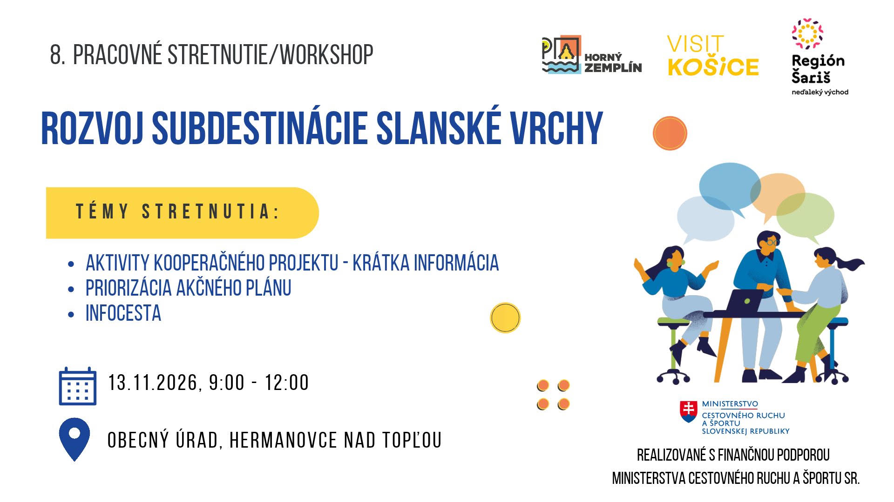
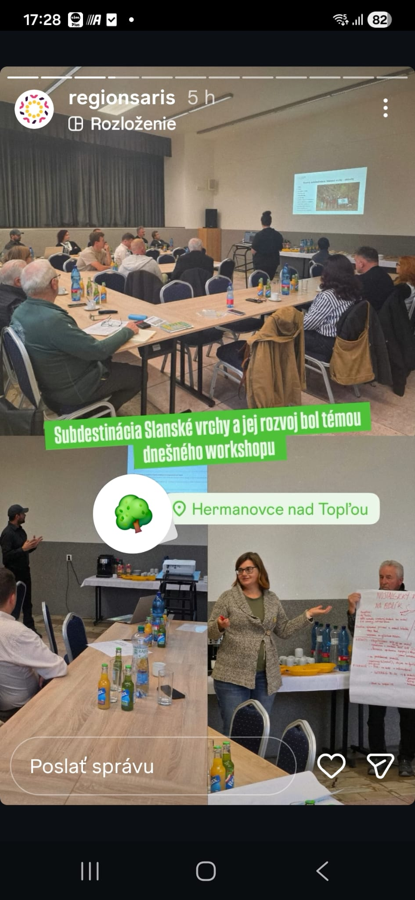

Pozvánka:

___

| Účasť za klub ||
|:-------------:|:-----------:|
| výbor | Matúš Ivanecký|
| členovia | František Pribula|

___

Toto pracovné stretnutie s témou Rozvoja Slanskych vrchov bolo FAJN, vidno, ze nieco sa riesi, dost kontaktov sa tam da získať a pokecať a najme sa da niecomu priučiť, čo može konať a využiť aj náš klub.

T.z. za mna to hodnotim pozitivne: je su za tym vidno aj vysledky.

___

___

